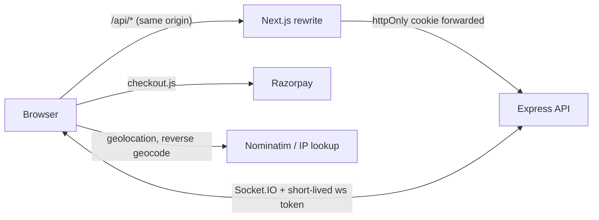

# EliteCrew — Home services marketplace

The web app for **EliteCrew**, a home-services marketplace. Customers book
verified professionals for AC, fridge, electrical, plumbing, cleaning and more.
Professionals manage their jobs, and admins run the whole platform, all from
one Next.js app with three role-based areas.

---

## What it does

| Customer | Professional | Admin |
| --- | --- | --- |
| Browse 19 service categories with upfront prices | Register and complete onboarding | Review and approve professionals |
| Smart search and location-aware results | See and manage assigned jobs | Manage the service catalog |
| Book a service and pay online | Share live location while on the way | Create coupons and offers |
| Track the professional on a live map | Maintain a public profile | Handle support tickets in real time |
| Rate the job after it is done | | Publish blog posts and job openings |
| Raise and follow support tickets | | Read contact messages and applications |

---

## Tech stack

| Piece | Tool | Used for |
| --- | --- | --- |
| Framework | Next.js 16 (App Router) | Pages, rewrites, metadata, sitemap |
| UI | React 19 | Components |
| Styling | Tailwind CSS 4, shadcn/ui on Base UI | Design system and primitives |
| Motion | Framer Motion | Page and component animation |
| HTTP | Axios | API client |
| Realtime | Socket.IO client | Notifications, support chat, live location |
| Maps | Leaflet | Live tracking and location picker |
| Payments | Razorpay Checkout | Online payment for bookings |

The Express backend is a separate project and is not part of this repository.

---

## Architecture



### One origin, cookie-based auth

The browser only ever calls `/api/...` on the site's own origin. A rewrite in
`next.config.mjs` forwards those calls (and `/uploads/...`) to the backend.
Because the request stays same-origin, the **httpOnly auth cookie** is sent
automatically and no token is ever read by client-side JavaScript.

`lib/api.js` is a small Axios instance with `withCredentials: true`. Its only
interceptor clears the cached user when the API answers `401`, so an expired
session logs the user out cleanly.

### Realtime without exposing the session

Socket.IO connects straight to the backend, so it cannot use the httpOnly
cookie. Instead:

1. The app asks `/api/auth/ws-token` for a short-lived socket token.
2. The token is passed in the Socket.IO handshake.
3. If the connection is rejected for an expired token, the client fetches a
   fresh one and reconnects on its own.

Events the UI listens for:

| Event | Used by |
| --- | --- |
| `notification:new` | Notification bell |
| `provider:location:update` | Live tracking map |
| `support:ticket:created`, `support:ticket:status`, `support:message:new` | Support chat for customers and admins |
| `contact:message:new`, `career:application:new` | Admin badges and toasts |

### Location, with fallbacks

`lib/location.js` finds the customer's city in this order and caches the
answer for six hours:

1. Cached value in `localStorage`
2. Browser Geolocation, reverse-geocoded with Nominatim
3. IP-based lookup
4. A default city

### Payments

`lib/razorpay.js` loads Razorpay's checkout script once and reuses it.

1. `POST /payments/order` with the booking id. The server decides the amount.
2. The checkout modal opens with that order.
3. On success the app calls `POST /payments/verify`. The booking is marked
   paid only after the server verifies the payment.

---

## Folder structure

```text
app/
  page.js                     home: categories, search, offers
  services/[category]/        services in a category
  book/[serviceSlug]/         booking flow
  bookings/  bookings/[id]/   booking list, detail and live tracking
  bookings/[id]/rate/         rating after the job
  providers/  offers/         browse professionals and offers
  support/  support/[ticketId]/   customer support tickets
  login/  register/  forgot-password/  profile/
  professional/login/  professional/register/
  provider/  provider/onboarding/    professional area
  dashboard/customer/  dashboard/provider/
  admin/                      admin console
    providers/  approved/  services/  coupons/
    support/  blog/  careers/  contact/
  blog/  careers/  about/  how-it-works/  help/  contact/  privacy/  terms/
  sitemap.js  robots.js  manifest.js

components/
  LiveTrackingMap.jsx   LocationPicker.jsx   LocationBar.jsx
  SmartSearch.jsx       NotificationBell.jsx
  SupportWidget.jsx     SupportBot.jsx
  admin-sidebar.jsx     provider-sidebar.jsx
  auth/  blog/  careers/  contact/
  ui/                   shadcn/ui primitives (button, sheet, sidebar, map …)

lib/
  api.js        Axios client that goes through the /api rewrite
  auth.js       session helpers
  socket.js     Socket.IO connection and ws-token refresh
  location.js   city detection and caching
  razorpay.js   checkout loader and payment flow
  services.js   service catalog: categories, prices, durations, inclusions
  seo.js        site URL and canonical helpers
```

---

## Run it locally

You need Node.js 20+ and the EliteCrew backend running (port `8080` by default).

```bash
git clone https://github.com/Gautam5514/service_provider_frontend.git
cd service_provider_frontend
npm install
```

Create `.env.local`:

```bash
NEXT_PUBLIC_API_URL=http://localhost:8080
NEXT_PUBLIC_SITE_URL=http://localhost:3000
```

Then start the dev server:

```bash
npm run dev      # http://localhost:3000
```

| Command | What it does |
| --- | --- |
| `npm run dev` | Start the app for local development |
| `npm run build` | Build the production version |
| `npm start` | Run the production build |
| `npm run lint` | Lint with ESLint |
