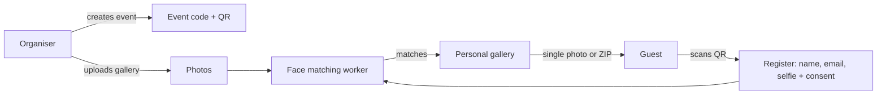
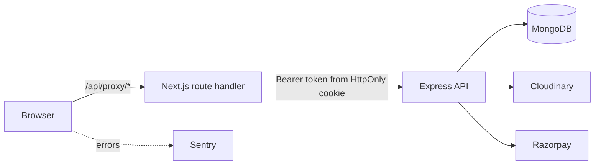

# FaceDeliver — Web app

The web surface of **FaceDeliver**, an event-photo delivery platform. A guest
scans the event QR code, takes one selfie, and gets a personal gallery of only
the photos they appear in. Organisers and photographers run their events,
uploads, analytics and billing from the same app.

Live at **[facedeliver.shop](https://facedeliver.shop)**. The Flutter client
for the same API lives in
[Gautam5514/facedeliver_app](https://github.com/Gautam5514/facedeliver_app).

---

## How the product works



1. The organiser creates an event and gets a unique event code and QR code.
2. The QR is shown at the venue. Guests scan it and register with a selfie.
3. The organiser uploads the event photos in batches.
4. The backend detects faces in every photo and matches them to registered guests.
5. Each guest gets an email and a private gallery with only their photos.

---

## Tech stack

| Piece | Tool | Used for |
| --- | --- | --- |
| Framework | Next.js 16 (App Router) | Pages, route handlers, metadata |
| UI | React 19 | Components |
| Styling | Tailwind CSS 4, `clsx`, `tailwind-merge` | Design system and utilities |
| Motion | Framer Motion | Landing page and dashboard animation |
| Icons | lucide-react | Icon set |
| QR | `qrcode` | Event QR generation for organisers |
| Payments | Razorpay Checkout | Plans and upload quota |
| Monitoring | Sentry (`@sentry/nextjs`) | Client and server error tracking |
| Offline shell | Service worker + web manifest | Installable PWA |

The backend this app talks to is a separate Express API with MongoDB
(Mongoose), Cloudinary for image storage and a face-matching worker. It is not
part of this repository.

---

## Architecture



### The proxy keeps the token out of JavaScript

The browser never calls the backend directly and never holds the auth token.

- On sign-in, `app/api/auth/session` stores the token in an **HttpOnly cookie**
  (`gopo_session`).
- Every API call goes to `app/api/proxy/[...path]`. The route handler reads the
  cookie on the server, adds the `Authorization: Bearer …` header and forwards
  the request to the backend.
- Hop-by-hop headers are stripped, the query string and multipart boundaries
  are preserved, and the proxy is marked `force-dynamic` so nothing is cached.
- The superadmin console has its own cookie and its own proxy
  (`app/api/superadmin-proxy`), so the two sessions never mix.

### Folder structure

```text
app/
  page.js                 landing page
  register/               guest registration: details, consent, selfie capture
  gallery/                the guest's personal gallery
  login/                  organiser sign-in
  admin/                  organiser console
    dashboard/  events/  events/[id]/  events/[id]/guests/
    analytics/  billing/  profile/  help/
  superadmin/             platform console (separate login and session)
    (secure)/dashboard/  (secure)/subscriptions/
  blog/  services/  how-it-works/  for-photographers/  about/  contact/  privacy/
  api/
    auth/session/         sets and clears the HttpOnly session cookie
    proxy/[...path]/      authenticated proxy to the backend
    superadmin-proxy/     the same, for the superadmin session
    contact/              contact form handler
  utils/
    api.js                apiCall / authFetch helpers that go through the proxy
    razorpay.js           checkout loader and payment flow
  sitemap.js  robots.js  seo.config.js

components/
  landing/                hero, how-it-works, features, FAQ, testimonials, footer
  admin/                  CreateEventModal
  layout/  ui/            shared layout and primitives
  ServiceWorkerRegistration.jsx

public/
  sw.js  manifest.json    PWA shell
```

---

## What each role can do

| Guest | Organiser | Superadmin |
| --- | --- | --- |
| Scan the event QR code | Create events and share the QR | See platform-wide revenue |
| Register with a selfie and explicit consent | Upload photo galleries in batches | Oversee every subscription |
| View only the photos they appear in | See the guest list for each event | |
| Download one photo or the whole album | Track delivery analytics | |
| | Manage plan, quota and billing | |

---

## Decisions worth knowing

- **Consent comes before the camera.** The registration page explains what is
  collected, where the selfie is stored and when it is deleted, and the guest
  has to tick the consent box before a selfie can be submitted.
- **The event code is the public key.** QR links, guest registration and
  galleries all use the event code, not the database id.
- **Payments are verified on the server.** The checkout modal reporting success
  is not enough. The plan and upload quota change only after the backend
  verifies the Razorpay signature.
- **SEO is built in.** `sitemap.js`, `robots.js` and a central `seo.config.js`
  cover the marketing pages, blog and service pages.
- **Production logs are quiet.** `console.*` calls are removed from production
  builds (errors are kept), and Sentry source maps are hidden from the browser.

---

## Run it locally

You need Node.js 20+ and the FaceDeliver backend running.

```bash
git clone https://github.com/Gautam5514/delivery_frontend.git
cd delivery_frontend
npm install
```

Create `.env.local`:

```bash
NEXT_PUBLIC_API_URL=http://localhost:5001/api
# optional
NEXT_PUBLIC_SENTRY_DSN=
```

Then start the dev server:

```bash
npm run dev      # http://localhost:3000
```

| Command | What it does |
| --- | --- |
| `npm run dev` | Start the app for local development |
| `npm run build` | Build the production version |
| `npm start` | Run the production build |
| `npm run lint` | Lint with ESLint |
